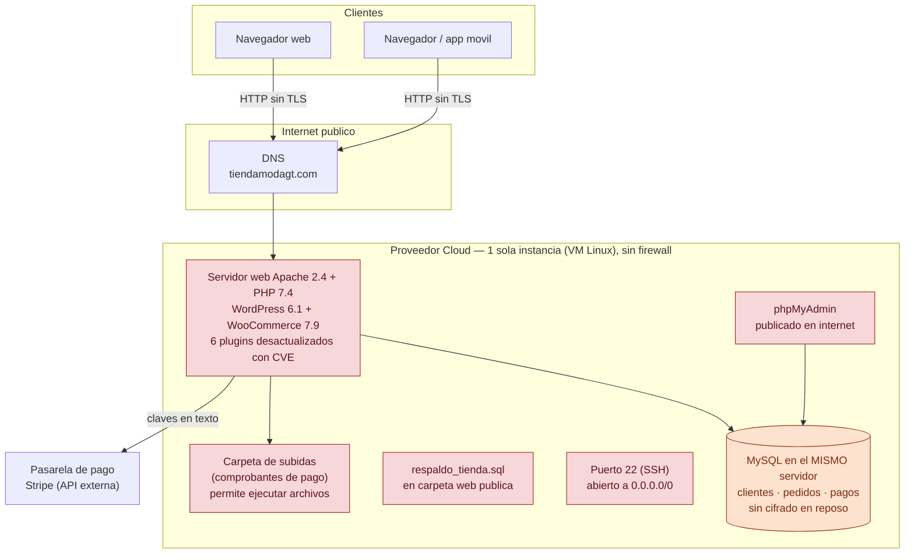
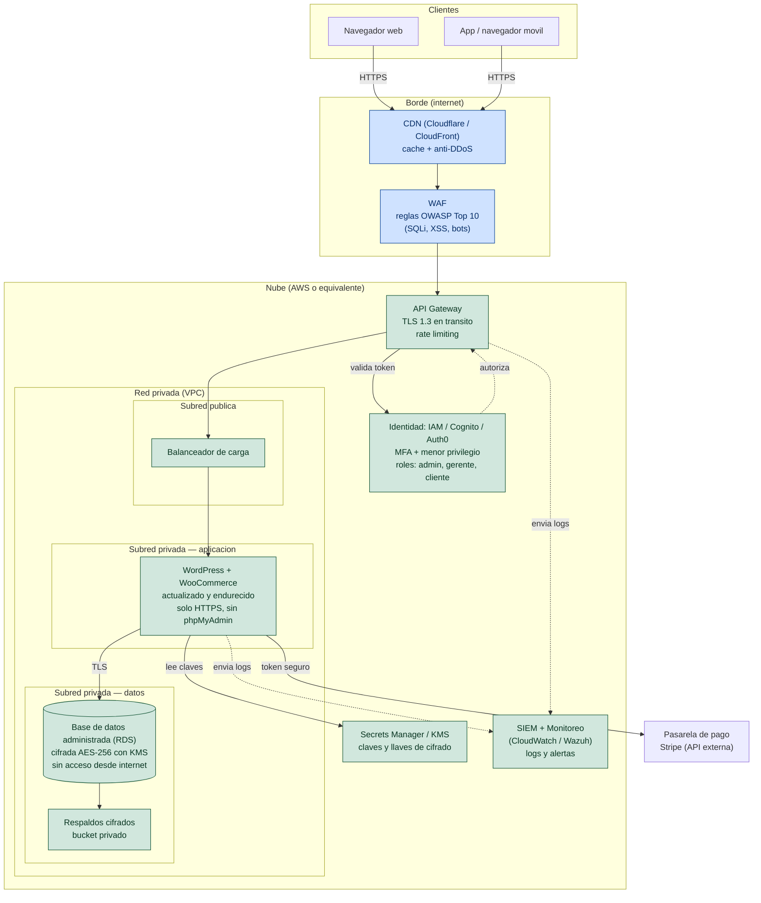

# Especificación técnica y arquitectura

Documento de referencia del laboratorio. Describe qué se eligió, qué tecnología usa y cómo está
construida la tienda **hoy** (versión vulnerable). Sirve como base para la Fase 1 y la Fase 2 del
informe del proyecto.

---

## 1. Opción elegida

**Opción B del proyecto: CMS / E-Commerce Web.**

Un **CMS** (Content Management System, o gestor de contenidos) es un programa que permite crear y
administrar un sitio web sin programarlo desde cero. **WordPress** es el CMS más usado del mundo.
Sobre WordPress se instala **WooCommerce**, un complemento que lo convierte en tienda en línea con
productos, carrito, pedidos y pagos.

| Aspecto | Decisión |
|---|---|
| Escenario | Tienda en línea de ropa, **Tienda Moda GT** |
| CMS | WordPress 6.1 |
| E-Commerce | WooCommerce 7.9 |
| Lenguaje | PHP 7.4 |
| Servidor web | Apache 2.4 |
| Base de datos | MariaDB 10.6 |
| Despliegue | Contenedores Docker, en `127.0.0.1` (local) |

Se eligió esta opción porque WordPress es de código abierto, su ecosistema de complementos es su
principal punto débil. Eso permite demostrar el OWASP Web Top 10 con vulnerabilidades reales.

---

## 2. Arquitectura actual en producción (as-is, vulnerable)

Así estaría desplegada la tienda **en un entorno real de producción** antes de aplicar seguridad. Es
el despliegue típico y económico de una tienda WooCommerce pequeña: un solo servidor en la nube que
expone todo a internet sin controles. Este es el diagrama **actual** que pide el entregable de la
Fase 1.

> Los nodos en rojo son los puntos débiles de esta arquitectura. **Quién los ataca y cómo** se
> documenta aparte, en el modelo de amenazas STRIDE/DREAD, no en el diagrama.

### Flujo de datos (producción)

1. El cliente (web o móvil) entra por el dominio **sin cifrado (HTTP)**, cualquiera en la red puede
   leer el tráfico.
2. El servidor Apache ejecuta WordPress y WooCommerce, con plugins que tienen CVE conocidos.
3. La base de datos MySQL vive en **el mismo servidor**, sin cifrado ni aislamiento.
4. El administrador y cualquier atacante llegan a **phpMyAdmin** y al **respaldo** directamente desde
   internet. El puerto **SSH** queda abierto a todo el mundo.

### Entorno de laboratorio (cómo se emula esta arquitectura)

No se despliega en la nube real. Se **emula la misma topología** con tres contenedores Docker en
`127.0.0.1`, para poder atacarla sin riesgo. El mapeo es directo:

| En producción (diagrama de arriba) | En el laboratorio (Docker) |
|---|---|
| Servidor web Apache + PHP | Contenedor `wordpress` → `http://127.0.0.1:8080` |
| MySQL en el servidor | Contenedor `db` (MariaDB 10.6) |
| phpMyAdmin expuesto | Contenedor `phpmyadmin` → `http://127.0.0.1:8081` |
| Respaldo y archivos expuestos | `respaldo_tienda.sql`, `info.php`, `adminer.php` |

### Por qué esta arquitectura es insegura

| Debilidad | Capa afectada (7 capas) |
|---|---|
| Plugins desactualizados con CVE públicos | Aplicación — Implementación |
| Versiones de PHP y Apache visibles en las cabeceras | Perímetro de aplicación |
| Errores de PHP mostrados al usuario | Aplicación — Código |
| Gestor de base de datos y respaldo accesibles desde la web | Datos |
| Enumeración de usuarios por la API REST | Aplicación — Autenticación |
| Sin WAF, sin cifrado en tránsito (solo HTTP), sin segmentación de red | Perímetro / Red |
| Base de datos en el mismo equipo, sin aislamiento | Host / Red interna |

Estas debilidades son el punto de partida. A continuación se propone el **rediseño seguro**.

---

## 3. Arquitectura rediseñada segura (propuesta para el informe)

Esta es la arquitectura objetivo. Cumple lo que pide la rúbrica: flujo del cliente hasta la base de
datos con **API Gateway**, **servicio de identidad (IAM)**, **WAF** y **almacenamiento cifrado**.

| Control que se agrega | Qué resuelve de la versión vulnerable |
|---|---|
| WAF | Bloquea SQLi, XSS y los ataques del OWASP Top 10 |
| API Gateway + TLS 1.3 | Cifra el tránsito, centraliza el acceso, oculta los servicios internos |
| IAM con menor privilegio y MFA | Evita el acceso no autorizado y la enumeración de usuarios |
| Base de datos administrada y cifrada (KMS) | Protege los datos en reposo, la aísla de la web |
| Red privada (VPC) con subredes | Separa la aplicación de la base de datos, no quedan en el mismo plano |

---

## 4. Componentes del repositorio

| Archivo / carpeta | Función |
|---|---|
| `docker-compose.yml` | Define los tres contenedores y la red local |
| `Dockerfile` | Construye la imagen de la tienda con los plugins vulnerables |
| `php-inseguro.ini` | Configuración PHP insegura intencional (errores visibles) |
| `plugins/` | WooCommerce y los seis plugins con CVE |
| `web-extra/` | Archivos expuestos a propósito (`info.php`, `adminer.php`) |
| `setup/instalar_tienda.sh` | Crea usuarios, productos y pedidos |
| `setup/mejorar_tienda.sh` | Idioma, imágenes, tema y limpieza |

---

## 5. Inventario rápido de activos (borrador para la Fase 1)

| Activo | Tipo | Ubicación | C | I | D |
|---|---|---|---|---|---|
| Datos de clientes (nombre, dirección, correo) | Información | Base de datos | Alta | Alta | Media |
| Pedidos y su historial | Información | Base de datos | Alta | Alta | Media |
| Credenciales de usuarios | Información | Base de datos | Alta | Alta | Alta |
| Configuración de pagos (Stripe) | Información | Base de datos | Alta | Alta | Media |
| Código de WordPress y plugins | Software | Contenedor wordpress | Media | Alta | Alta |
| Base de datos MariaDB | Software | Contenedor db | Alta | Alta | Alta |
| Servidor Apache / PHP | Servicios | Contenedor wordpress | Media | Media | Alta |

> C = Confidencialidad, I = Integridad, D = Disponibilidad. Valoración: Alta / Media / Baja.
> Esta tabla se amplía en el informe con propietario, custodio, criticidad calculada y justificación.
