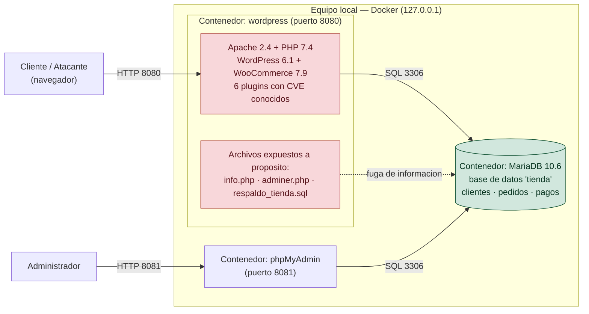

# Tienda Moda GT — Laboratorio vulnerable (WordPress + WooCommerce)

> ⚠️ **Solo para fines educativos.** Esta tienda contiene vulnerabilidades **a propósito**.
> Corre únicamente en `127.0.0.1` dentro de Docker. **Nunca la expongas a internet** ni uses
> su código o sus claves en un sistema real.

Proyecto Final del curso **Seguridad en Aplicaciones** — Maestría en Seguridad Informática, UMG.
Escenario de la **Opción B (CMS / E-Commerce)**: una tienda en línea para analizar, atacar y asegurar.
Todo corre dentro de Docker, en la computadora de cada quien (`127.0.0.1`).

> 📐 **Especificación técnica completa, diagrama y arquitectura:** ver [ARQUITECTURA.md](ARQUITECTURA.md)

---

## Arquitectura actual (hoy, vulnerable)

Un **CMS** es un gestor de contenidos para crear sitios web sin programarlos desde cero. Aquí se usa
**WordPress** (el CMS más común) con **WooCommerce**, el complemento que lo vuelve tienda en línea.
El laboratorio levanta tres contenedores Docker que se comunican en una red local.



**Qué la hace insegura:** plugins desactualizados con CVE, versiones de software visibles, errores de
PHP expuestos, gestor de base de datos y respaldo accesibles desde la web, sin WAF ni cifrado TLS.
El rediseño seguro se propone en la Fase 4 del informe. El detalle está en
[ARQUITECTURA.md](ARQUITECTURA.md).

---

## 1. Qué necesita cada integrante

| Requisito | Mac | Windows |
|---|---|---|
| Docker Desktop | [Descargar](https://www.docker.com/products/docker-desktop/) e instalar | Igual (necesita WSL2, el instalador lo activa) |
| Memoria libre | ~4 GB | ~4 GB |
| Nada más | No se instala PHP, MySQL ni WordPress aparte | Igual |

> **Mac con chip M1/M2/M3:** funciona tal cual. Se usa MariaDB (no MySQL 5.7), que sí tiene
> versión para estos chips, así que **no hace falta activar Rosetta**.

---

## 2. Cómo se enciende (fácil)

1. Abrir **Docker Desktop** y esperar a que diga *Running*.
2. Entrar a la carpeta del proyecto y hacer **doble clic**:
   - En Mac: `INICIAR-mac.command`
   - En Windows: `INICIAR-windows.bat`
3. La primera vez tarda unos minutos (descarga e instala todo). Al terminar abre la tienda solo.

Para apagarla (sin perder datos): doble clic en `APAGAR-mac.command` o `APAGAR-windows.bat`.

> Si en Mac aparece *"no se puede abrir porque es de un desarrollador no identificado"*:
> clic derecho sobre el archivo → **Abrir** → **Abrir**. Solo la primera vez.

### Alternativa por terminal (si el doble clic falla)

```bash
docker compose up -d --build
docker compose run --rm wpcli sh /setup/instalar_tienda.sh
docker compose run --rm wpcli sh /setup/mejorar_tienda.sh
```

---

## 3. Direcciones y accesos

| Qué | Dirección | Usuario / clave |
|---|---|---|
| Tienda | http://127.0.0.1:8080 | — |
| Panel de administración | http://127.0.0.1:8080/wp-admin | `admin` / `admin123` |
| phpMyAdmin (base de datos) | http://127.0.0.1:8081 | servidor `db`, `root` / `root123` |

### Usuarios de la tienda (para probar control de acceso)

| Usuario | Clave | Rol | Para qué sirve |
|---|---|---|---|
| `admin` | `admin123` | Administrador | Control total |
| `gerente` | `gerente123` | Gestor de tienda | Pedidos y productos |
| `editor` | `editor123` | Editor | Contenido |
| `cliente1` | `cliente123` | Cliente | Comprador normal |
| `cliente2` | `123456` | Cliente | Clave débil a propósito |

---

## 4. Qué trae la tienda

- **10 productos** de ropa con foto, precio en quetzales (GTQ) y stock.
- **4 pedidos** de clientes con nombre, dirección y teléfono (datos para probar fugas de información).
- **3 métodos de pago**: transferencia, contra entrega y tarjeta (Stripe en modo prueba).
- **2 páginas** que usan plugins vulnerables: subir comprobante y buscar en el catálogo.
- Tema **Storefront** (el oficial de WooCommerce) en español.

---

## 5. Vulnerabilidades incluidas (esto es el material del proyecto)

> Estos "defectos" **son intencionales**. Son justo lo que el grupo debe encontrar, documentar y
> luego corregir en el informe. **No se arreglan antes de documentarlos.**

### Plugins con CVE conocidos

| Plugin | Versión | Vulnerabilidad | CVE |
|---|---|---|---|
| WooCommerce Stripe Gateway | 7.4.0 | IDOR: ver datos de pedidos de otros clientes sin login | CVE-2023-34000 |
| Themify WooCommerce Product Filter | 1.4.9 | Inyección SQL sin login (crítico 9.8) | CVE-2024-6027 |
| WordPress File Upload | 4.12.2 | Subida de archivos hasta ejecución de código (RCE) | CVE-2020-10564 |
| Social Warfare | 3.5.2 | Cambio de configuración sin login / XSS | CVE-2019-9978 |
| InfiniteWP Client | 1.9.4.4 | Saltarse el inicio de sesión del administrador | CVE-2020-8772 |
| WP Advanced Search | 3.3.3 | Acceso no autorizado a la base de datos | — |

### Malas configuraciones y exposiciones

| Hallazgo | Dónde se ve |
|---|---|
| Versiones de software expuestas | Cabeceras `Server: Apache` y `X-Powered-By: PHP/7.4.33` |
| Errores de PHP visibles al usuario | `display_errors = On` |
| Enumeración de usuarios | http://127.0.0.1:8080/wp-json/wp/v2/users |
| Archivo de diagnóstico olvidado | http://127.0.0.1:8080/info.php |
| Gestor de base de datos expuesto | http://127.0.0.1:8080/adminer.php |
| Respaldo de la base de datos accesible | http://127.0.0.1:8080/respaldo_tienda.sql |
| `xmlrpc.php` habilitado | Permite fuerza bruta y amplificación |
| Clave de cliente débil | `cliente2` / `123456` |
| Registro de usuarios abierto | Cualquiera puede crear cuenta |

---

## 6. Cómo cada fase del proyecto usa esta tienda

| Fase del proyecto | Qué se hace sobre la tienda | Herramientas |
|---|---|---|
| **1. Riesgos** | Inventario de activos (clientes, pedidos, pagos), STRIDE/DREAD, 7 capas, diagrama | Threat Dragon, draw.io, Excel |
| **2. DevSecOps** | Revisar el código PHP de los plugins y las dependencias | Semgrep (SAST), Trivy (SCA), GitHub Actions |
| **3. Ciberdefensa** | Escaneo y ataque de la tienda corriendo | Nmap, WPScan, OWASP ZAP, Burp, Postman |
| **4. Contenedores** | Revisar las imágenes y el `docker-compose` | Trivy, Checkov |
| **5. Operación** | WAF, mitigación, tratamiento del riesgo, heatmap antes/después | ModSecurity, Wordfence |

---

## 7. Estructura de la carpeta

```
lab/
├── INICIAR-mac.command        ← doble clic (Mac) para encender todo
├── INICIAR-windows.bat        ← doble clic (Windows) para encender todo
├── APAGAR-mac.command / .bat  ← apagar sin perder datos
├── docker-compose.yml         ← define los contenedores (tienda, base de datos, phpMyAdmin)
├── Dockerfile                 ← construye la imagen vulnerable de la tienda
├── php-inseguro.ini           ← configuración PHP insegura (intencional)
├── plugins/                   ← WooCommerce y los plugins vulnerables
├── web-extra/                 ← archivos expuestos a propósito (info.php, adminer.php)
└── setup/
    ├── instalar_tienda.sh     ← crea la tienda, usuarios, productos y pedidos
    ├── mejorar_tienda.sh      ← idioma, imágenes reales, tema y limpieza
    └── imagenes/              ← fotos de los productos
```

---

## 8. Reglas de seguridad del laboratorio

- **No exponerla a internet.** Es vulnerable de verdad. Cada quien la corre en su propia máquina.
- **No usar estas claves ni este código en nada real.**
- Para borrar todo y empezar de cero: `docker compose down -v` (borra también los datos).
